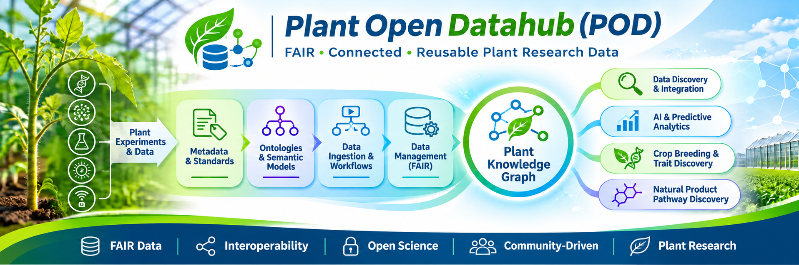

# 🌱 Plant Open Datahub (POD)

### Connecting Plant Research Through FAIR Data

**FAIR Data | Semantic Technologies | Open Science**

An initiative led by the
[Integrative Bioinformatics Lab](https://github.com/IntegrativeBioinformaticsLab)
at Maastricht University.
Project coordinator: Dr. Kumar Saurabh Singh (PI, IBL, Brightlands Future Farming Institute, Maastricht University, the Netherlands)

